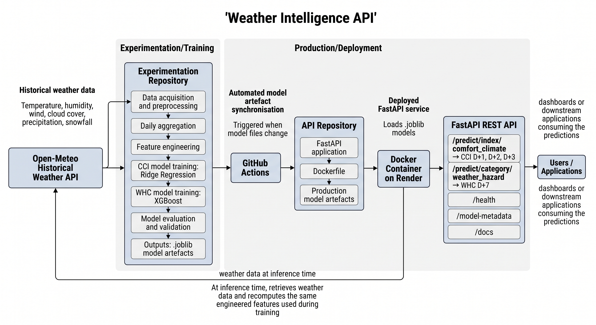

# Weather Intelligence API — Experimentation Repository (AT2)

## Student and Assessment Information

**Student:** Parisa Kalaki
**Student ID:** 25969686
**Unit:** 36120 Advanced Machine Learning Application, Spring 2026
**Assessment:** AT2 — Machine Learning as a Service

## Project Description

This repository contains the experimentation, data preparation, feature
engineering, and model development work for two weather forecasting
services built for Open Meteo's Weather Intelligence API:

- **Climate Comfort Index (CCI)** — a Ridge Regression model predicting a
  0–100 outdoor comfort score for 1, 2, and 3 days ahead for Sydney, NSW.
- **Weather Hazard Category (WHC)** — a multiclass classification model
  (XGBoost) predicting a hazard risk level (Low/Moderate/High/Extreme
  Risk), exactly 7 days ahead, for Sydney, NSW.

Both models are trained on historical weather observations (2010-2025)
retrieved from the Open-Meteo Historical Weather API, and are deployed
as REST endpoints via a companion FastAPI repository (see
[36120-26SP-AT2-25969686-api](https://github.com/ParisaKalaki/36120-26SP-AT2-25969686-api).

## Architecture



## Model Artefacts

The trained models are saved as Joblib artefacts and used by the companion
FastAPI service:

```
models/
├── comfort_climate/
│   ├── ridge_pipeline_1d.joblib
│   ├── ridge_pipeline_2d.joblib
│   └── ridge_pipeline_3d.joblib
└── weather_hazard/
    └── xgboost_classifier.joblib
```

The three CCI pipelines correspond to the **+1-day, +2-day, and +3-day**
prediction horizons.

## GitHub Actions Model Synchronisation

As an additional engineering workflow, this repository includes a GitHub
Actions workflow that synchronises trained model artefacts with the companion
FastAPI API repository.

The **`Sync Models to API Repo`** workflow:

1. Detects changes to `.joblib` model files in the `models/` directory.
2. Checks out the experimentation repository and the companion API repository.
3. Copies the updated model artefacts into the corresponding API `models/`
   directories.
4. Commits and pushes the updated artefacts to the API repository when changes
   are detected.

The workflow can also be triggered manually using GitHub Actions. This
provides a simple automated mechanism for keeping the deployed API model
artefacts aligned with the experimentation repository.

This automation is **additional project infrastructure and is not a required
component of the AT2 assessment**. It supports the MLaaS deployment workflow
and reduces the need to copy model artefacts manually between repositories.

## Analysis Reports

The notebooks generate the following figures in the `reports/` directory:

- **Climate Comfort Index:** feature importance, predicted-versus-actual,
  and residual plots.
- **Weather Hazard Category:** feature importance and training confusion
  matrix plots.

These report artefacts support model interpretation and evaluation alongside
the metrics produced in the notebooks.

## Project Organization

```bash
├── notebooks/
│ ├── comfort_climate/ <- CCI experimentation notebook
│ └── weather_hazard/ <- WHC experimentation notebook
├── models/
│ ├── comfort_climate/ <- Saved Ridge pipelines for +1, +2 and +3 days
│ └── weather_hazard/ <- Saved XGBoost model
├── data/ <- Raw/interim/processed data (git-ignored;
│ regenerated by running the notebooks)
├── reports/
│ ├── comfort_climate/ <- CCI evaluation and interpretation figures
│ └── weather_hazard/ <- WHC evaluation and interpretation figures
├── at2_experiments/ <- Local project package (Cookiecutter Data
│ Science structure)
├── tests/ <- Unit tests for at2_experiments
├── pyproject.toml <- Project dependencies and configuration
└── uv.lock <- Locked dependency versions
```

## Setup Instructions

This project uses [uv](https://docs.astral.sh/uv/) for environment and
dependency management.

1. **Install uv** (if not already installed):

```bash
   curl -LsSf https://astral.sh/uv/install.sh | sh
```

2. **Clone this repository and enter it:**

```bash
   git clone https://github.com/ParisaKalaki/36120-26SP-AT2-25969686-experiments.git
   cd 36120-26SP-AT2-25969686-experiments
```

3. **Pin the Python version and create the virtual environment:**

```bash
   uv python pin 3.12.11
   uv venv
```

4. **Install the project dependencies:**

```bash
uv sync
```

5. **Register the Jupyter kernel:**

```bash
   uv run python -m ipykernel install --user --name=at2-env --display-name "Python (AT2)"
```

6. **Launch Jupyter Lab:**

```bash
   uv run jupyter lab
```

7. **Run the notebooks** in order, starting from the top of each:
   - `notebooks/comfort_climate/36120-26SP-AT2-25969686-comfort_climate.ipynb`
   - `notebooks/weather_hazard/36120-26SP-AT2-25969686-weather_hazard.ipynb`

   Each notebook fetches historical weather data directly from the
   Open-Meteo API (no manual data download required), performs data
   preparation and feature engineering, trains its respective model, and
   saves the resulting model artefact to the appropriate `models/`
   subfolder.

## API Usage

The deployed Weather Intelligence API is available on Render and provides CCI and WHC predictions.

**API documentation:** [Swagger UI](https://three6120-26sp-at2-25969686-api.onrender.com/docs)

### Health check

```bash
curl https://three6120-26sp-at2-25969686-api.onrender.com/health
```

### CCI prediction

Returns D+1, D+2, and D+3 comfort predictions for a supplied date.

```bash
curl "https://three6120-26sp-at2-25969686-api.onrender.com/predict/index/comfort_climate?date=2025-12-20"
```

### WHC prediction

Returns the D+7 weather hazard category.

```bash
curl "https://three6120-26sp-at2-25969686-api.onrender.com/predict/category/weather_hazard?date=2025-12-20"
```

### Model metadata

```bash
curl https://three6120-26sp-at2-25969686-api.onrender.com/model-metadata
```

The API accepts historical dates within the supported data period; 2026+ dates are reserved as unseen production data.

## Running Tests

```bash
uv run pytest -v
```

## Dependencies

Core dependencies (see `pyproject.toml` for full list and versions):
`pandas`, `numpy`, `scikit-learn`, `xgboost`, `matplotlib`, `seaborn`,
`requests`, `36120-26sp-ml-utils-25969686`,
published to TestPyPI).

## Custom Package

This project extends and uses the custom Python package originally
developed for AT1 and published as
`36120-26sp-ml-utils-25969686` on TestPyPI). See that package's
own repository and README for details on the generic utilities added
during this extension (`transformations.py`, `evaluation.py`,
`exploration.py`).
